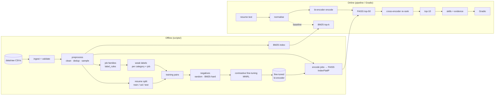

# Architecture and data design (Phase 2)

This document fixes the module boundaries, data schemas, label and split protocols, inter-module
API contracts and artifact layout that Phases 3–9 implement. It describes the **design**; the
README's architecture diagram (Phase 9) must describe what was actually built. Settings referenced
as `file.yaml: key` live in `configs/`. The reasons for each choice are in [DECISIONS.md](DECISIONS.md).

---

## 1. System overview



Evaluated systems (`retrieval.yaml: systems`): **A** BM25, **B** pretrained MiniLM + FAISS,
**C** fine-tuned MiniLM + FAISS, **D** C + cross-encoder re-ranking of the top 50.

---

## 2. Module responsibilities and API contracts

Signatures are contracts: later phases may add optional parameters but must not change these.
"✔" = implemented (signatures below are as built); everything else is planned for the phase shown.

| Module | Phase | Responsibility | Public API |
|---|---|---|---|
| `src/config.py` ✔ | 2 | Load YAML configs, apply smoke-test overrides, resolve storage roots | `load_config(name, *, smoke_test=None, config_dir=None) -> dict`; `load_all_configs(...)`; `resolve_path(kind, rel) -> Path`; `storage_root(kind)`; `ConfigError` |
| `src/data/label_rules.py` ✔ | 2 | Pure weak-label rules: title → job families; (category, families, codes) → grade | `LabelRules.from_config(cfg)`; `.assign_families(title) -> tuple[str,...]`; `.grade(category, families, codes) -> Judgment(grade, confidence, rule)`; `.included_categories`; `normalize_title()` |
| `src/utils/logging_utils.py` ✔ | 3 | Logger setup; privacy-safe text summaries | `get_logger(name)`; `describe_text(text) -> str` (length + short hash, never content) |
| `src/utils/reproducibility.py` ✔ | 3 | Seeds, fingerprints, atomic writes, run metadata | `set_seed(seed, deterministic)`; `stable_seed(seed, key)`; `atomic_write(path)` (yields a temp path, renamed on success); `atomic_write_json/text`; `fingerprint_jobs(job_ids, job_texts) -> str`; `file_sha256(path)`; `config_hash(cfg)`; `environment_info() -> dict` |
| `src/data/ingest.py` ✔ | 3 | Read raw files via the column mapping, join lookups, emit canonical frames | `load_resumes(data_cfg) -> DataFrame`; `load_jobs(data_cfg) -> DataFrame` (both with `.attrs["ingest"]`: source, row count, malformed lines, notes); `read_table(path, fmt, columns)`; `make_ids(...)`; raises `DataMissingError` (with download steps), `SchemaError` |
| `src/data/validate.py` ✔ | 3 | Required fields, nulls, duplicates, statistics | `validate_resumes(df, stage)`, `validate_jobs(df, stage) -> ValidationReport` (stage `raw`: fixable problems are warnings; `processed`: all are errors); `.ok / .errors / .warnings / .stats / .to_dict() / .raise_if_errors()` |
| `src/data/preprocess.py` ✔ | 3 | Text cleaning, HTML stripping, dedup, near-dup audit, job sampling, text templates | `clean_text(text, cfg)`; `strip_html(text)`; `clean_resumes(raw, cfg) -> (kept, dropped)`; `clean_jobs(raw, cfg) -> (kept, dropped)`; `deduplicate_resumes(df) -> (kept, dropped)`; `deduplicate_jobs(df) -> (kept, aliases)`; `near_duplicate_groups(ids, texts, threshold, method) -> (groups, pairs)`; `sample_jobs(jobs, rules, cfg, seed) -> (sample, stats)`; `subsample_resumes(df, n, seed)`; `build_texts(df, template)`; `render_text(record, template)` |
| `src/data/build_labels.py` ✔ | 3 | Apply `LabelRules` to the corpus; category×job labels; training positives | `assign_job_families(jobs, rules)`; `build_category_labels(jobs, rules, mapping_version)`; `apply_min_support(labels, n) -> (labels, excluded)`; `label_summary(labels)`; `category_grades(labels, category)`; `build_positive_pairs(resumes, splits, labels, pairs_cfg, seed, use_splits=("train",))` (raises `LeakageError` for test) |
| `src/data/split.py` ✔ | 3 | Resume-level stratified, group-aware train/val/test split | `split_resumes(resumes, split_cfg) -> DataFrame[resume_id, resume_category, near_dup_group, split]` (groups and `label_status` read from columns); `assert_partition_isolation(splits)`; `assert_only_splits(frame, splits, allowed, what)` |
| `src/data/prepare.py` ✔ | 3 | Orchestrate CLI steps 1–4 with skip-if-current, a manifest and the freeze check | `run_validation(configs)`; `prepare_data(configs, force=False, unfreeze=False) -> PrepareResult` |
| `src/data/freeze.py` ✔ | 3 | Frozen corpus and label mapping (`data/labels/FROZEN.json`) | `labels_yaml_sha256()`; `load_frozen()`; `write_frozen(version, corpus_fingerprint, n_jobs)`; `check_frozen(corpus_fingerprint=None, check_labels=True, unfreeze=False)` (raises `FrozenArtifactError`) |
| `src/retrieval/bm25.py` ✔ | 3 | System A | `tokenize(text, cfg)`; `BM25Retriever(cfg).fit(job_ids, texts)`; `.scores(text)`; `.search(text, k) -> list[ScoredJob]`; `.save(dir, meta)` / `BM25Retriever.load(dir, expected: dict)` |
| `src/retrieval/biencoder.py` ✔ | 3 | Load a SentenceTransformer; encode to float32 unit vectors | `BiEncoder(model_id_or_path, max_seq_length, device, model=None)`; `.encode(texts, batch_size) -> np.ndarray[n, d]`; `.model_id`; `.dimension`; `.fingerprint()` |
| `src/retrieval/faiss_index.py` ✔ | 3 | Build/persist/load/verify FAISS `IndexFlatIP` + ID map + metadata | `JobIndex.build(embeddings, job_ids, meta)`; `.search(query_vecs, k) -> list[list[ScoredJob]]`; `.save(dir)`; `JobIndex.load(dir, expected: dict)`; `IndexMismatchError`, `MissingArtifactError` |
| `src/retrieval/reranker.py` | 5 | Cross-encoder scoring; reports when unavailable | `CrossEncoderReranker(model_id, max_length, device)`; `.available: bool`; `.rerank(resume_text, candidates, job_texts) -> list[ScoredJob]` |
| `src/retrieval/pipeline.py` ✔ (3 of 4 systems) | 3 + 5 | Index building and querying for every system | `load_corpus(data_cfg) -> Corpus`; `build_index(system, configs, force=False) -> (dir, built)`; `MatchingPipeline.from_config(system, configs)`; `.search(resume_text, top_k_retrieve=None, top_k_final=None) -> SearchResult`; `.job_metadata(job_id)` |
| `src/training/pairs.py` ✔ | 4 | Training data, named run configs, positive pairs (+ validation), negative eligibility | `resolve_run_config(training_cfg, run_name) -> dict`; `load_training_data(data_cfg) -> TrainingData` (resumes, splits, labels, corpus, `job_groups`, fingerprints); `prepare_positive_pairs(data, pairs_cfg, seed, split="train"\|"val")` (test raises `LeakageError`); `validate_positive_pairs(pairs, data, pairs_cfg, allowed_splits)`; `eligible_negatives(data, negatives_cfg) -> {category: job_ids}`; `duplicate_groups(job_ids, near_dup_pairs, text_hashes)` |
| `src/training/mine_hard_negatives.py` ✔ | 4 | Random and BM25 negatives for TRAINING resumes only; the persisted training-pair file | `mine_bm25_negatives(train_resumes, positives, eligible, retriever, negatives_cfg, seed, *, splits, query_text) -> DataFrame`; `sample_random_negatives(positives, resume_category, eligible, per_pair, seed, *, splits) -> DataFrame` (both raise `LeakageError` for non-train resumes); `build_negative_set(mode, data, run_cfg, configs, force=False) -> NegativeSet(frame, path, meta, reused)` |
| `src/training/losses.py` ✔ | 4 | MNRL with in-batch false-negative masking (D24, D58) | `MaskedMultipleNegativesRankingLoss(model, row_category, row_jobs, negative_ok, scale)`; `.candidate_mask(labels, n_doc_columns)` |
| `src/training/validation.py` ✔ | 4 | Checkpoint selection: weak-label NDCG@10 on VAL resumes (D61) | `WeakLabelRetrievalEvaluator(queries, corpus, grades, k, gain)`; `build_validation_evaluator(data, validation_cfg)` |
| `src/training/train_biencoder.py` ✔ | 4 | MNRL fine-tuning via `SentenceTransformerTrainer`; checkpoints; resume; config export | `pair_rows(pairs, n_negatives)`; `build_training_dataset(rows, data, n_negatives, label_offset=0) -> datasets.Dataset`; `masking_tables(...)`; `check_training_freeze(configs, data, unfreeze)`; `train(run_name, configs, force=False, unfreeze=False) -> TrainResult(run_name, run_dir, final_dir, skipped, meta)` |
| `src/training/train_cross_encoder.py` | optional | Optional cross-encoder fine-tuning experiment (not implemented; `cross_encoder.finetune: false`) | `train(configs) -> Path` |
| `src/evaluation/metrics.py` | 6 | Pure metric functions | `ndcg_at_k(ranked, rels, k, gain)`; `reciprocal_rank(ranked, rels, threshold)`; `recall_at_k(ranked, rels, k, threshold)` |
| `src/evaluation/latency.py` | 6 | Per-stage timing with warm-up | `time_system(pipeline, texts, cfg) -> DataFrame` |
| `src/evaluation/evaluate.py` | 6 | Run every system on the test resumes with one judgment set | `evaluate(systems, test_resumes, judgments, cfg) -> EvalResult` |
| `src/evaluation/ablation.py` | 6 | Random vs hard negatives, same budget | `run_ablation(configs) -> DataFrame` |
| `src/evaluation/labeling.py` | 6 | Blind pooled export; validate/import manual grades | `create_pool(...) -> (pool_df, key_df)`; `import_judgments(path) -> DataFrame` |
| `src/evaluation/reports.py` | 6 | CSV, Markdown table, plots, config dump, report, bootstrap CIs | `write_reports(result, out_dir)`; `paired_bootstrap(per_query_a, per_query_b, cfg)` |
| `src/explainability/skills.py` | 7 | Vocabulary-based skill extraction | `SkillMatcher.from_config(cfg)`; `.extract(text) -> set[str]` |
| `src/explainability/match_evidence.py` | 7 | Per-result evidence | `explain(resume_skills, job, ranked_job) -> MatchEvidence` |
| `src/app/gradio_app.py` | 7 | UI only; calls `predict` | `predict(resume_text, system, show_stages) -> dict` (pure, unit-tested); `build_app(...) -> gr.Blocks` |

**Shared result types** (defined in `src/retrieval/types.py`, re-exported by `src/retrieval/pipeline.py`; shared exceptions live in `src/errors.py`):

```python
@dataclass(frozen=True)
class ScoredJob:            # one candidate
    job_id: str
    score: float            # BM25 score, cosine similarity, or raw cross-encoder logit

@dataclass(frozen=True)
class RankedJob:
    job_id: str
    rank: int                       # 1-based final rank
    retrieval_score: float          # stage-1 score
    rerank_score: float | None      # raw cross-encoder score; None if not re-ranked
    ranking_stage: str              # "bm25" | "biencoder" | "cross_encoder" | "biencoder_fallback"

@dataclass(frozen=True)
class SearchResult:
    system: str
    candidates: list[RankedJob]     # stage-1 list (top_k_retrieve)
    results: list[RankedJob]        # final list (top_k_final)
    fallback_used: bool             # True if the cross-encoder was requested but unavailable
    timings_ms: dict[str, float]    # encode, retrieve, rerank, end_to_end
```

Error contract: empty or whitespace-only resumes raise `EmptyInputError`; missing artifacts raise
`MissingArtifactError` naming the script that creates them; fingerprint, model or dimension mismatches
raise `IndexMismatchError` listing each differing field. The UI turns these into readable messages.

---

## 3. Data schemas (canonical, Parquet in `data/processed/`)

IDs are strings built from source IDs: `resume_id = "R" + Resume.csv ID`, `job_id = "J" + job_postings job_id`.
They never depend on row order. If a source ID is missing, the fallback is `"R-" + sha1(text)[:12]`
(or `"J-"` for jobs), and the fallback is reported.

### `resumes.parquet` (one row per kept resume)

| Field | Type | Origin |
|---|---|---|
| `resume_id` | str | `"R"` + `ID` |
| `resume_text` | str | `Resume_str` cleaned (NFKC, whitespace collapsed); tag-stripped `Resume_html` if `Resume_str` is empty |
| `resume_category` | str | `Category` |
| `text_source` | str | `Resume_str` or `Resume_html` |
| `n_words` | int | derived |
| `text_sha1` | str | sha1 of `resume_text` (used for dedup and logs) |
| `near_dup_group` | str | ID of the near-duplicate cluster (a singleton cluster is its own `resume_id`) |
| `label_status` | str | `included` / `excluded` (from `labels.yaml: categories`) |

### `jobs.parquet` (the job corpus every system indexes, after dedup and sampling)

| Field | Type | Origin |
|---|---|---|
| `job_id` | str | `"J"` + `job_id` |
| `job_title` | str | `title`, cleaned |
| `job_description` | str | `description`, HTML stripped, cleaned |
| `company` | str, nullable | `companies.csv: name` joined on `company_id` |
| `location` | str, nullable | `location` |
| `employment_type` | str, nullable | `formatted_work_type` |
| `job_category` | str, nullable | derived: `"|"`-joined `job_families` (there is no source category column) |
| `job_families` | list[str] | `LabelRules.assign_families(job_title)` |
| `function_codes` | list[str] | `job_skills.csv: skill_abr` (used only for weak labels) |
| `formatted_experience_level`, `remote_allowed`, salary fields, `job_posting_url` | nullable | passed through (`data.yaml: jobs.metadata_columns`) |
| `text_sha1` | str | sha1 of the job text built from `data.yaml: text.job` |

### Other processed files

| File | Grain | Columns |
|---|---|---|
| `job_aliases.parquet` | dropped duplicate job | `alias_job_id`, `job_id` (kept copy) |
| `splits.parquet` | resume | `resume_id`, `resume_category`, `near_dup_group`, `split` ∈ {train, val, test} |
| `category_job_labels.parquet` | (category, job), complete for included categories | `resume_category`, `job_id`, `grade` (Int8, null = uncertain), `confidence`, `rule`, `mapping_version` |
| `data_report.json` | run | sizes, category distributions, missing-value stats, duplicates, warnings |
| `manifest.json` | run | per-file rows and sha256, `corpus_fingerprint`, `mapping_version`, config hashes, git commit, timestamp |

Weak labels depend only on (resume category, job), so they are stored at that grain
(about 23 × 10,000 rows) instead of 25 million resume × job rows. A resume's label for a job
is the label of its category. Training pairs are written separately (see §4.3).

---

## 4. Weak-label protocol

1. **Families.** Each job title gets 0..n families from regexes in `labels.yaml: job_families`.
   (On the deduplicated corpus, 75.6% of jobs get at least one family and 12.3% get several;
   see `docs/LABEL_MAPPING_REVIEW.md`.)
2. **Grade.** `LabelRules.grade` applies the nine ordered rules documented at the top of
   `labels.yaml`. The output is a grade (0/1/2, or *uncertain*), a confidence (high/medium/low)
   and the rule name. LinkedIn function codes corroborate titles; generic codes (OTHR, MGMT, GENB)
   are ignored.
3. **Categories.** 23 categories are included. AGRICULTURE is excluded because only 10 jobs get
   grade 2, below `min_highly_relevant_jobs: 20`. Excluded categories' resumes stay in
   `resumes.parquet` but are left out of splits, training and evaluation.
4. **Provenance.** Every label carries `label_source = "weak:labels.yaml"`, the rule name and
   `mapping_version` (sha256 of `labels.yaml`).

### 4.1 Uses of each grade

| Use | Jobs eligible |
|---|---|
| Training positives | grade 2 with confidence ≥ medium; at most 8 per resume, seeded sample (`training.yaml: pairs`) |
| Random negatives | grade 0 with high confidence (the title is in an unrelated family) |
| BM25 hard negatives | the same pool, restricted to the resume's BM25 top 100; one drawn from the top 20 eligible |
| Never used as negatives | grade 1, uncertain, grade-0 low confidence, known positives, alias duplicates of positives |
| Secondary (weak-label) evaluation | grades as stored; uncertain counts as 0 (`evaluation.yaml: judgments.unjudged_as`) |
| Primary evaluation | manual judgments only (§6) |

### 4.2 Known limitation

Labels are category-level, so every resume in a category gets the same positives, and weak-label
errors produce false positives and false negatives (e.g. "Pharmaceutical Sales" matches healthcare).
Hard-negative mining can therefore pick true positives as negatives. The README must document this.

### 4.3 Training-pair file (`artifacts/negatives/<mode>.parquet`)

`resume_id, positive_job_id, negative_job_id (null when mode=none), negative_index, label, label_source, rule, confidence, negative_source (none|random|bm25|random_fallback), bm25_rank, notes`.
One row per (resume, positive, negative); `label` is the positive's weak grade. Only TRAINING resumes
appear. `<mode>.meta.json` records the inputs (seed, pair and negative settings, corpus, mapping and
split fingerprints), a summary and the file's sha256. The file is reused while all of these match;
`--force` regenerates it. Eligible negatives exclude whole duplicate groups (D59); a pair with too few
eligible BM25 hits is filled at random (D60).

---

## 5. Split protocol

1. **Population.** Resumes from included categories that survive cleaning: drop empty ones and
   those under `min_resume_words`, and keep the lowest ID of each exact-duplicate pair (both Phase 1
   pairs are exact duplicates).
2. **Near-duplicate groups.** TF-IDF cosine ≥ `data.yaml: dedup.resumes.near_duplicate_audit.threshold`
   puts resumes in one group. Groups are reported, never dropped, and always land in one partition.
3. **Test split (20%).** `StratifiedGroupKFold(n_splits=5, shuffle=True, random_state=seed)`,
   stratified by `resume_category` and grouped by `near_dup_group`. One fold becomes `test`.
4. **Validation split.** The same procedure with `n_splits=10` on the remaining resumes. One fold
   becomes `val` (about 10% of train). The rest is `train`.
5. **Isolation guarantees** (tests in Phase 3–4):
   - every `resume_id` appears in exactly one split;
   - no `near_dup_group` spans splits;
   - training pairs, negatives and hard-negative mining touch `train` resumes only;
   - checkpoint selection uses `val`;
   - `test` is read only by evaluation and the labelling pool.
6. **Jobs** are shared by all partitions. Retrieval runs over a fixed, known corpus, and the README
   discloses this. Test judgments never reach training: manual labels are stored in a file the
   training code never reads, and weak labels are category-level, independent of individual test resumes.
7. **Actual size** (Phase 3 run, seed 42): 2,418 included resumes → 1,740 train, 194 val, 484 test.
   Every included category has at least 4 test resumes (BPO has the fewest). On tiny smoke subsets,
   where no category can fill every fold, the split falls back to unstratified group folds and logs
   a warning (D45).

---

## 6. Evaluation protocol (summary of `evaluation.yaml`)

- **Same test resumes, same judgments and same code for every system.**
- **NDCG@10.** Gain = 2^rel − 1. IDCG uses all judged jobs for the resume.
- **MRR.** Relevant means rel ≥ 1. A strict variant (rel = 2) is also reported.
- **Recall@10 and Recall@50.** The universe is the jobs judged relevant (rel ≥ 1). With manual
  judgments this is **pooled recall**, an upper bound because unjudged relevant jobs are missed.
- **Primary judgments.** Manual 0/1/2 grades for about 40 test resumes. Pool = union of the top 10
  from the four systems, shuffled, with system identity hidden. A separate key file records which
  system retrieved each pair.
- **Secondary judgments.** Weak labels, always labelled "weak-label evaluation".
- **Latency.** Encode / retrieve / rerank / end-to-end, after 5 warm-up runs. Mean, median and p95.
  Excludes model loading and corpus encoding. Hardware is recorded. CPU and GPU numbers are never
  mixed in one comparison.
- **Uncertainty.** Paired bootstrap over test resumes (1,000 resamples, 95% CI).
- **Ablation.** The random-vs-hard table also reports each arm's negative sources from
  `artifacts/negatives/<mode>.meta.json` (`summary.negative_source`), in particular the number of
  hard-negative pairs filled at random (`random_fallback`; 344 of 13,920 pairs on the labels-v1 data, D60).

---

## 7. Text representation and truncation

All systems use one template per document type (`data.yaml: text`):
job = `"{job_title}. {job_description}"`, resume = `"{resume_text}"`.
The bi-encoders truncate at `max_seq_length: 256` tokens and the cross-encoder at 512 for the
(resume, job) pair, truncating longest-first. Truncation always drops the end of the text, so the
job title and the resume headline and summary are kept. Most texts are longer than this
(median resume 757 words, median job 468 words). Chunking with pooling is future work.

---

## 8. Artifact naming and versioning

```
data/processed/                     # git-ignored; rebuilt by scripts/prepare_data.py
  resumes.parquet  jobs.parquet  job_aliases.parquet  splits.parquet
  category_job_labels.parquet  dropped_rows.parquet
  near_duplicates_resumes.parquet  near_duplicates_jobs.parquet
  data_report.json  data_report.md  manifest.json        # manifest written last
data/processed_smoke/               # same layout, written by --smoke-test (D40)
data/labels/                        # manual_judgments.csv is committed (IDs + grades only)
  labeling_pool.csv  labeling_pool_key.csv  manual_judgments.csv  llm_judgments.csv
artifacts/                          # git-ignored; root relocatable via RJM_ARTIFACTS_DIR (Drive in Colab)
  indexes/bm25/                     # weights.npz (sparse BM25 weights)  vocab.json  job_ids.json  meta.json
  indexes/<system>/                 # system ∈ {pretrained, finetuned}
    index.faiss  embeddings.npy  job_ids.json  meta.json
  indexes_smoke/...                 # same layout, written by --smoke-test
  models/<run_name>/                # run_name ∈ {biencoder_random, biencoder_hard}
    checkpoints/checkpoint-<step>/  final/  training_config.yaml  train_log.jsonl
    run_inputs.json  meta.json      # meta.json is written last and marks a finished run
  negatives/<mode>.parquet  <mode>.meta.json   # mode ∈ {none, random, hard}
  models_smoke/  negatives_smoke/   # same layouts, written by --smoke-test
results/                            # git-ignored; relocatable via RJM_RESULTS_DIR
  evaluation/<run_id>/              # run_id = YYYYMMDD-HHMMSS
    metrics.csv  per_query.csv  results.md  ablation.md  config.json  report.md  plots/*.png
```

**Fingerprints**, recorded in each `meta.json` and checked on load:

| Field | Definition |
|---|---|
| `corpus_fingerprint` | sha256 of the sorted lines `job_id \t sha1(job_text)`; changes if any job or the text template changes |
| `mapping_version` | sha256 of `labels.yaml` |
| `model_id` | HF model ID, or the run directory for fine-tuned models |
| `model_fingerprint` | sha256 of the model's `model.safetensors` (fine-tuned) or the HF revision hash (pretrained) |
| `text_template`, `max_seq_length`, `dimension`, `normalize_embeddings`, `index_type` | copied from config |
| `created_at`, `git_commit`, `library_versions` | provenance |

**Restart safety.** Every writer uses `atomic_write` (temp file then rename). A step is skipped when
its outputs exist and their recorded input fingerprints match the current ones. `--force` rebuilds.
A partial run never leaves a half-written file under a final name.
